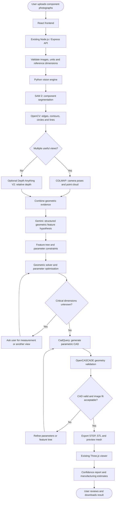

# ReForge AI: Target Workflow

Goal: photos of a mechanical component -> validated parametric CAD (STEP/STL) + preview mesh + confidence report.
This file is the source of truth for the pipeline. Implement it stage by stage; do not skip the decision nodes.

## 1. Flow diagram



## 2. Architecture decisions (already made)

| Area | Decision |
|---|---|
| Job model | Target: async job + polling. `POST /api/jobs` creates a job, frontend polls `GET /api/jobs/:id`. No long blocking requests. **Interim (until the job layer exists):** `POST /api/cad/build` may block, but must return the same job-shaped object (`jobId`, `state`, `progress`, `warnings`, `needsInput`, `result`, `error`) so polling can replace it without frontend changes. Give the CAD call its own timeout. Measure real build time to decide when to build the job layer. |
| Scale policy | The 3D solid is always shown. STEP/STL export requires at least one **anchor dimension**: a `user`-typed dimension, or a `measured` one from a calibrated source (adequate-confidence calibration, or a metric-classified solver result). Gemini estimates never count as an anchor. Without an anchor the result is a labeled relative preview and export is blocked, enforced server-side. Dimensions other than the anchor may be `estimated`, but must be labeled, and exports carry a note when any estimate is present. |
| Gear routing | Gears use the legacy `/cad/generate` path. The feature-tree/solver path handles solver-derived revolved parts (shafts, flanges, bearings, brackets). Do not extend `legacy_recipe_to_feature_recipe` for gears yet. |
| CAD contract order | 1) Legacy `/cad/generate` for all recipe styles first (it is the only path that supports gears and needs no schema translation). 2) `/cad/generate-advanced` for non-gear solver-derived parts. 3) `/cad/from-reconstruction` once solver output exists. Do not remove the legacy route. |
| Provenance labels | `user`, `measured`, `estimated`. Python's existing sources map as: `user_dims` -> `user`, `solver_result` -> `measured`, `recipe` and `default` -> `estimated`. |
| Runtime | Separate services, launched by a PowerShell dev script with health checks. Do NOT merge Python services into one app (keeps fail-open isolation and avoids dependency conflicts). **Current state:** `python-engine/app.py` (port 8766) hosts both reconstruction and CAD endpoints, and the vision service is separate (port 8765). Keep service URLs configurable and split reconstruction from CAD when COLMAP is added. |

## 3. Services

| Service | Language | Owns |
|---|---|---|
| Express API (existing) | Node.js | Validation, job creation/state, polling endpoint, orchestration, serving frontend |
| Vision service | Python / FastAPI | SAM 2 segmentation, OpenCV feature extraction, optional Depth Anything V2 |
| Reconstruction service | Python | COLMAP camera poses and point cloud |
| CAD service | Python / FastAPI | Feature tree, solver, CadQuery generation, OpenCASCADE validation, STEP/STL export |
| Frontend (existing) | React + Vite + Three.js | Upload, job progress, input prompts, 3D viewer, report, downloads |

Gemini calls stay server-side. The API key is never exposed to the browser.
Vision, Reconstruction and CAD currently share the repository-root `.venv` on Python 3.13. Their dependencies are declared together in root `requirements.txt`; install PyTorch/TorchVision separately from the official CUDA wheel index, then install the pinned SAM2 package. Services remain separate processes. Revisit the shared environment only if a demonstrated dependency conflict prevents installation or runtime use.

## 4. Stage-by-stage spec

### 4.1 Intake (Express)
- Accept one or more images. Validate type, size, count, and readability.
- Validate units and any reference dimension (mm/in, positive number, which feature it refers to).
- Create a job and return its id immediately.

### 4.2 Vision (Python)
1. **SAM 2**: segment the component from the background. Output mask per image.
2. **OpenCV**: edges, contours, circles (Hough), lines. Output as JSON (pixel coordinates + confidence).
3. **Decision: multiple useful views?** A view is "useful" if it has a good mask, enough texture/overlap with other views, and sufficient resolution.
   - Yes -> COLMAP (poses + point cloud).
   - No -> optional Depth Anything V2 (relative depth only, not metric).
4. **Combine geometric evidence**: merge masks, contours, circles, lines, and point cloud/depth into one evidence object with per-item confidence.

Fail open: if COLMAP or depth fails, continue single-view and lower the confidence. Do not fail the job.

### 4.3 Hypothesis and constraints
- **Gemini** receives the images plus the evidence object and returns a structured feature hypothesis (strict JSON schema): component type, features (holes, bores, steps, teeth, flanges), rough dimensions, material and process estimate.
- Convert the hypothesis into a **feature tree with parameter constraints** (e.g. bore concentric with outer diameter, N bolt holes on a pitch circle).
- Rule: Gemini proposes, measured geometry decides. Where OpenCV/solver measurements conflict with Gemini numbers, measurements win.

### 4.4 Solver and parameter optimisation
- Fit parameters so the model's projected silhouette/features match the SAM mask and OpenCV features.
- Anchor scale using the user/reference dimension if present.
- Track provenance per dimension: `user | measured | estimated` (see the label mapping in section 2).
- Forward raw OpenCV observations (circles, contours) to the solver. Reducing them to counts for the Gemini prompt is not enough.

### 4.5 Decision: critical dimensions unknown?
- Yes -> job enters `needs_input`. Ask the user for a measurement or another view. On reply, resume at the solver (4.4).
- No -> continue to CAD generation.
- No anchor dimension at all -> relative preview only; export stays blocked (see scale policy).

### 4.6 CAD generation and validation
1. **CadQuery** generates the parametric CAD from the solved feature tree.
2. **OpenCASCADE** validates geometry (valid solid, no self-intersections, positive volume).
3. **Decision: CAD valid and image fit acceptable?**
   - No -> refine parameters or feature tree, regenerate. Cap at 3-5 iterations; if still failing, go to `needs_input` or `failed` with a clear reason.
   - Yes -> export.

### 4.7 Output
- Export STEP, STL, and a preview mesh for Three.js.
- Show in the existing Three.js viewer.
- Produce a **confidence report** (per-dimension provenance, fit score, which stages fell back) and **manufacturing estimates** (material, process).
- User reviews and downloads.

## 5. Job states

```
queued -> validating -> segmenting -> extracting -> reconstructing (optional)
       -> hypothesizing -> solving -> needs_input (pausable, resumes at solving)
       -> generating_cad -> validating_cad -> refining (loops to generating_cad)
       -> exporting -> done
any -> failed (with reason)
```

`GET /api/jobs/:id` returns: `state`, `progress`, `warnings[]`, `needs_input` (what is asked), `result` (when done), `error` (when failed).

## 6. Build order

1. Job layer in Express (create, poll, states, resume). Interim: a blocking `POST /api/cad/build` returning the same job-shaped object (see section 2).
2. Vision service: SAM 2 + OpenCV on a single image -> JSON.
3. Single-view path: depth (optional) -> Gemini -> feature tree -> CadQuery for simple revolved parts -> STEP/STL.
4. Solver + silhouette-fit validation loop with iteration cap.
5. COLMAP branch (heaviest, add last).
6. Scale enforcement (export gate), confidence report, manufacturing estimates.
7. PowerShell dev script starting all services with health checks.

## 7. Rules for the implementer

- Keep services independent; communicate over HTTP/JSON.
- Every stage returns a confidence value and warnings; nothing silently falls back.
- Never export STEP/STL without an anchor dimension (user-typed or calibrated). Other dimensions may be estimated but must be labeled.
- Never let the refine loop run unbounded.
- Do not call Gemini from the frontend.

## 8. Amendment log

- 2026-11-14: Job model interim, anchor-dimension scale policy, CAD contract order, provenance label mapping, and current python-engine layout recorded. Original decisions are kept in the table and noted as the target where they differ.
